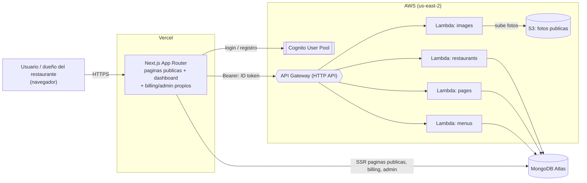

# TuMenuAhora

Menú digital para bares y restaurantes: carta online con diseño propio, pedidos derivados a WhatsApp, panel de administración y un plan de suscripción simulado, corriendo sobre una arquitectura cloud real (AWS + MongoDB Atlas + Vercel).

**Demo en producción:** https://foodhub-silk-two.vercel.app

## El problema a resolver

Un dueño con más de un local (o alguien que administra restaurantes de terceros) no tenía forma accesible de darle a cada uno su propia página y su propio menú digital: las soluciones existentes cobran por local o no contemplan manejar varios desde un mismo lugar. TuMenuAhora resuelve eso, una sola cuenta administra todos los restaurantes que hagan falta, cada uno con su página, su menú y su propio plan.

Del lado de la materia, el objetivo era desplegar una arquitectura cloud real y no un mock: un frontend en un proveedor serverless (Vercel), autenticación gestionada (Cognito), una API serverless (API Gateway + Lambda), almacenamiento de objetos (S3) y una base de datos administrada (MongoDB Atlas), todo integrado y funcionando en vivo.

## Arquitectura



Vercel aloja el frontend Next.js, que renderiza server-side las páginas públicas de cada restaurante (`/slug` y `/slug/menu`) leyendo Mongo directo, y además expone un puñado de rutas API propias para billing (plan simulado) y el panel de admin ,  esas dos cosas quedaron fuera de Lambda a propósito, no forman parte del flujo que pedía la materia. Cognito maneja el login y el registro reales (alta, confirmación por email, recuperación de contraseña), y el frontend manda el ID token de Cognito como `Authorization: Bearer` en cada llamada autenticada. El CRUD de restaurantes, páginas, menús e imágenes vive en cuatro funciones Lambda (Node 20 + TypeScript) detrás de API Gateway, cada una validando ese token antes de tocar la base. Las fotos (logo, portada, platos) se guardan en S3 y se sirven públicas con caché larga. MongoDB Atlas es la única base de datos, usada tanto por las Lambdas como por el frontend.


El detalle de cómo está desplegada la infraestructura (parámetros del stack, variables de entorno, permisos IAM) está en [`infra/README.md`](infra/README.md).

## Funcionalidades principales

Una misma cuenta puede administrar varios restaurantes. Cada restaurante guarda varias páginas y varios menús como colecciones separadas, cada una con su propio diseño (5 opciones para página, 5 para menú); de cada colección solo una puede quedar publicada a la vez, algo que se hace cumplir del lado del servidor y no solo en la interfaz. En el menú público, sin necesidad de login, el visitante puede armar un pedido y mandarlo como mensaje de WhatsApp prearmado al restaurante, sin que quede guardado en ninguna base. Desde el panel se genera al vuelo el código QR de la página o del menú, descargable como PNG. Cada restaurante necesita un plan activo (página, menú o ambos) para que su contenido se vea públicamente ,  es un plan simulado, pero el corte es real: si vence, el contenido deja de mostrarse solo, y vuelve a aparecer solo con renovarlo. Las cuentas con rol admin ven un panel con todos los usuarios y su facturación recurrente estimada, y quedan exceptuadas de pagar un plan.

## Cómo probarlo

### En producción (sin instalar nada)

Sin login, ya se puede ver una página y un menú públicos reales (tienen un plan activo, por eso se muestran):

- https://foodhub-silk-two.vercel.app/la-tahona-del-puerto
- https://foodhub-silk-two.vercel.app/kaff-bardo/menu (acá se puede probar el carrito y el botón de WhatsApp)

Para entrar al panel hay que registrarse con un email propio en https://foodhub-silk-two.vercel.app/login ,  Cognito manda un código de verificación real por correo. Una vez adentro se puede crear un restaurante, armar una página y un menú, subir fotos (se guardan en S3), generar el código QR de cada uno, y simular la contratación de un plan desde "Plan y facturación" para que el contenido se publique al público.

### En local (con Docker)

Requiere Docker y acceso a la misma base de MongoDB Atlas (pedir el `.env.local` real, no se commitea).

```bash
docker compose up -d
# la app queda en http://localhost:3002
```

El frontend local habla contra el mismo backend de AWS que producción (Cognito, API Gateway, S3) ,  no hay una versión local separada del backend.

### Verificación de código

```bash
cd frontend && npx tsc --noEmit && npx eslint . && npm run build
cd infra && npm run typecheck
```

## Estructura del repositorio

```
frontend/   Next.js (App Router) ,  frontend + rutas propias de billing/admin
infra/      AWS SAM ,  API Gateway + 4 Lambdas + bucket S3 (ver infra/README.md)
```

## Stack

Next.js 16 (App Router, Turbopack) · TypeScript · Tailwind CSS · MongoDB Atlas · AWS Cognito · AWS Lambda + API Gateway (Node 20) · AWS S3 · AWS SAM · Vercel.
